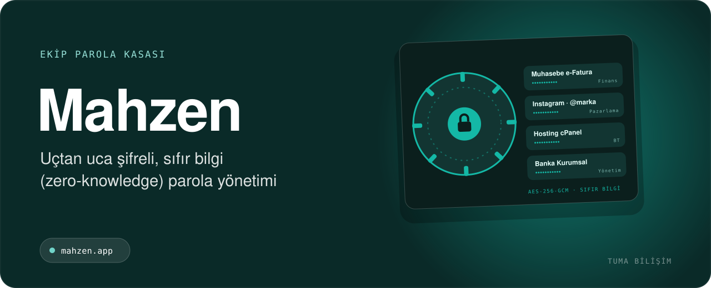

  

    

<h3 align="center">Ekibinizin ortak hesap şifrelerini güvenle paylaşın. Şifreleme tarayıcıda yapılır; sunucu sadece şifreli veriyi görür, şifrelerinizi asla okuyamaz.</h3>

 

## 🎯 Kimler için?

- Ajanslar ve yazılım/BT ekipleri
- Ortak hesap şifresi paylaşan KOBİ'ler
- Bireysel kullanıcılar

## ✨ Öne çıkan özellikler

- AES-256-GCM + RSA-OAEP ile uçtan uca şifreleme
- Sıfır bilgi mimarisi: anahtarlar ana paroladan tarayıcıda türetilir
- Güvenli paylaşım ve ortak ekip kasaları
- Rol bazlı erişim kontrolü
- Ekipten biri ayrıldığında otomatik kasa anahtarı yenileme
- Güç kontrollü parola üreteci, içe/dışa aktarma
- Denetim kaydı ve kayıt geçmişi
- Framework bağımlılığı yok; paylaşımlı hostingte çalışır

## 🧱 Teknoloji

`PHP` `MySQL` `Web Crypto API` `JavaScript`

## 📬 Demo, kurulum ve fiyat

Mahzen için canlı demo, kurulum ve fiyat bilgisi almak isterseniz:

- 🌐 **Teklif formu:** [tumabilisim.com/iletisim](https://tumabilisim.com/iletisim?urun=Mahzen)
- 💬 **WhatsApp:** [+90 533 432 15 12](https://wa.me/905334321512?text=Merhaba%2C%20Mahzen%20hakk%C4%B1nda%20bilgi%20almak%20istiyorum.)
- ✉️ **E-posta:** [info@tumabilisim.com](mailto:info@tumabilisim.com?subject=Mahzen%20hakk%C4%B1nda)

İşletmenize özel uyarlama ve entegrasyon da yapıyoruz.

---

<b>🇬🇧 English</b>

 

**Mahzen** — Zero-knowledge team password vault. End-to-end encryption in the browser (AES-256-GCM + RSA-OAEP), shared team vaults, role-based access, automatic key rotation and audit logs.

Live product: https://mahzen.app · Contact: [info@tumabilisim.com](mailto:info@tumabilisim.com) · WhatsApp: [+90 533 432 15 12](https://wa.me/905334321512)

---

Bu depo ürün tanıtımı içindir. Ürün ticari bir yazılım olduğundan kaynak kodu paylaşılmamaktadır. Kurulum, demo ve fiyat bilgisi için iletişime geçin. 
Tasarım & Geliştirme: <a href="https://tumabilisim.com">Tuma Bilişim</a> · <a href="https://github.com/gkhnfyz">@gkhnfyz</a>
